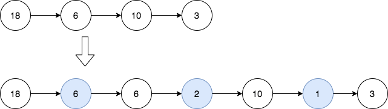

# 2807. 在链表中插入最大公约数

题目链接 : https://leetcode.cn/problems/insert-greatest-common-divisors-in-linked-list/

给你一个链表的头 head ，每个结点包含一个整数值。

在相邻结点之间，请你插入一个新的结点，结点值为这两个相邻结点值的 最大公约数 。

请你返回插入之后的链表。

两个数的 最大公约数 是可以被两个数字整除的最大正整数。



## 思路

首先是 `gcd()` 的思路不能忘记

`d | a && d | b` 那么可以推导出 `d | b &&  d | a % b` 

其次就是

1. 使用 `dummy` 数组来进行移动

2. 并且记录一个 `pre` 指针，只有在 `pre` 指针赋值的时候，我们进行求解

3. 创建一个 ==TempNode== 然后链接 `pre->temp->next` 即可

## Code 

```go
func gcd(a, b int) int {
    if b != 0{
        return gcd(b, a % b)
    }
    return a
}

func insertGreatestCommonDivisors(head *ListNode) *ListNode {
    var pre, dummy *ListNode = nil , head 

    for dummy != nil {
        if pre != nil {
            temp := gcd(pre.Val ,  dummy.Val)
            node := &ListNode{Val: temp, Next: dummy}
            pre.Next = node 
        }
        pre = dummy
        dummy = dummy.Next
    }
    return head 
}
```


