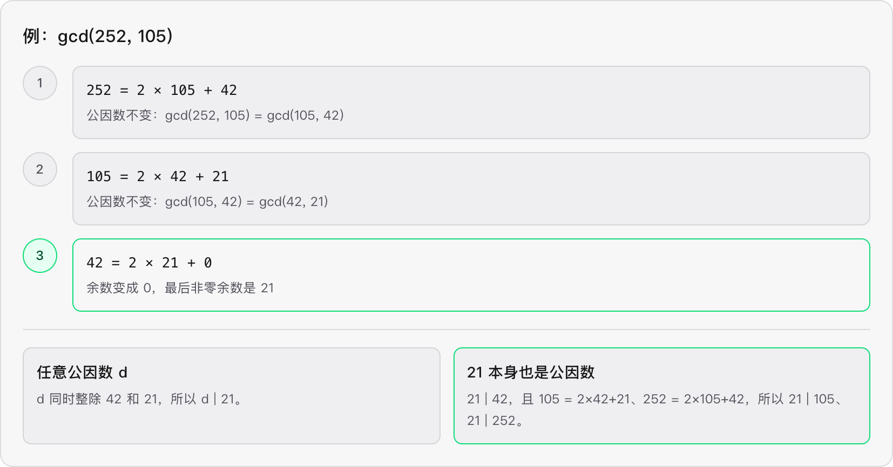

# 辗转相除法 

`d | a` 说明 ==a 可以被 d 整除==

那么可以推断出

`d | a 且 d | b  ⇔  d | b 且 d | (a mod b)`

因为 `a % b` 那么只会剩下整数倍的 `d`

因此就可以说明 `(a,b)` 和 `(b, a % b)` 的公因数相同，因此他们的最大公因数也相同




## Code

```go
func gcd(a,b int) int {
    if b != 0 {
        return gcd(b, a%b)
    }
    return a
}
```

同理 我们也可以 替换 `a`

所以你可以把“第一个参数`a` ”理解成当前拿来做除数的数；当它变为`0` 时，第二个参数就是最后一个非零余数，也就是 GCD。

```go
func gcd(a, b int) int {
    for a != 0 {
        a, b = b%a, a
    }
    return b
}
```