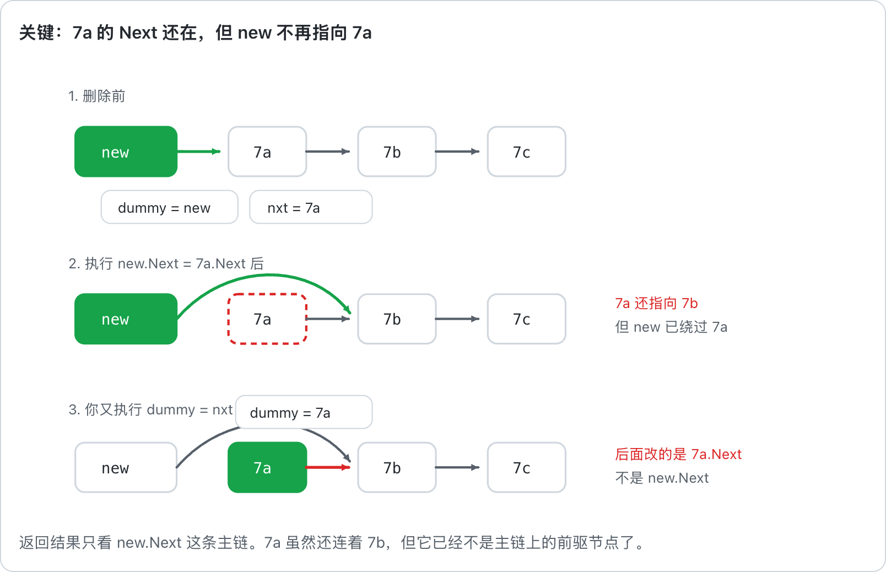

# 203. 移除链表元素

题目链接 : https://leetcode.cn/problems/remove-linked-list-elements/description/

给你一个链表的头节点 head 和一个整数 val ，请你删除链表中所有满足 Node.val == val 的节点，并返回 新的头节点 。

## 思路

删除链表，我们可以通过 `head.Next == head.Next.Next` 来进行模拟删除

但是有一个问题就是，我们怎么删除头节点因此需要引入 ==`emptyNode{Next: head}` 和 `dummy`==


## 错误展示

一开始我代码是这么写的，我想着 ==我如果删除了第二个节点，那么第三个节点应该由第二个节点进行删除== 所以我又给他指回去了

这导致 我虽然删除了，第三个节点，但是我只是删除了已经被删除节点的关系 如下

```go
for dummy != nil {

    nxt := dummy.Next
    
    if dummy.Next != nil && dummy.Next.Val == val {
    
        dummy.Next = dummy.Next.Next
    
    }

    dummy = nxt

}
```



## Code 

```go
func removeElements(head *ListNode, val int) *ListNode {
    newList := &ListNode{Next: head}
    dummy := newList

    for dummy != nil {
        if dummy.Next != nil && dummy.Next.Val == val {
            dummy.Next = dummy.Next.Next
        }else {
            dummy = dummy.Next
        }
    }

    return newList.Next
}
```


# 3217. 从链表中移除在数组中存在的节点

题目链接 : https://leetcode.cn/problems/delete-nodes-from-linked-list-present-in-array/description/

给你一个整数数组 nums 和一个链表的头节点 head。从链表中移除所有存在于 nums 中的节点后，返回修改后的链表的头节点。

## 思路

经验包，无非是上面那个变形 引入一个 ==map== 进行额外的判断即可

## Code

```go
func modifiedList(nums []int, head *ListNode) *ListNode {
    mp := make(map[int]bool)
    for _, v := range nums {
        mp[v] = true 
    }

    newList := &ListNode{Next: head}
    dummy := newList

    for dummy.Next != nil {
        if _, ok := mp[dummy.Next.Val] ; ok {
            dummy.Next = dummy.Next.Next
        }else {
            dummy = dummy.Next
        }
    }
    return newList.Next
}
```

# 83. 删除排序链表中的重复元素

题目链接 : https://leetcode.cn/problems/remove-duplicates-from-sorted-list/description/

给你一个 升序排列 的链表，包含若干重复的节点，请你删除这些节点，使每个节点只出现一次 。返回 最终 升序排列的 链表 。

## 思路

1. 同样的 是我们上面的改版，无非是把 ==判断条件改成 dummy.Next.Val == dummy.Next.Next.Val==


## Code 

```go
func deleteDuplicates(head *ListNode) *ListNode {
    newList := &ListNode{Next:head}
    dummy := newList

    for dummy.Next != nil && dummy.Next.Next != nil  {
        if dummy.Next.Val == dummy.Next.Next.Val {
            dummy.Next = dummy.Next.Next
            // node -> 1 -> 1
        }else {
            dummy = dummy.Next
        }
    }
    return newList.Next
}
```

# 82. 删除排序链表中的重复元素 II

题目链接 : https://leetcode.cn/problems/remove-duplicates-from-sorted-list-ii/description/

给你一个 升序排列 的链表，包含若干重复的节点，请你删除这些节点，使每个节点只出现一次 。返回 最终 升序排列的 链表 。

## 思路

这个需要==完全删除重复元素== 

根据数组的做法我们可以知道，我们直接 二重循环，判断一段连续区间的值即可 然后直接指向过去

同理我们可以

1. ==额外开辟一重循环，寻找重复元素==

## Code 

```go
func deleteDuplicates(head *ListNode) *ListNode {
    newList := &ListNode{Next:head}
    dummy := newList

    for dummy.Next != nil {
        preV := dummy.Next.Val

        fi := dummy.Next.Next
        for fi != nil && fi.Val == preV {
            fi = fi.Next
        }

        if fi != dummy.Next.Next {
            dummy.Next = fi 
            continue 
        }
        dummy = dummy.Next
        
    }
    return newList.Next
}
```


