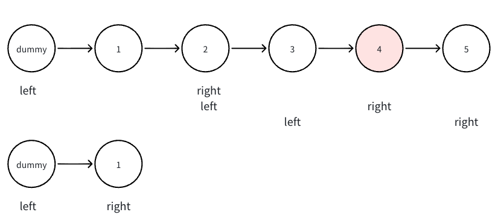

```go
func removeNthFromEnd(head *ListNode, n int) *ListNode {
    idx, cur :=0 , head 
    for cur != nil {
        idx ++ 
        cur = cur.Next
    }
    length := idx 
    idx, cur = 0 , head 
    
    dummy := &ListNode{Next: head}
    cur = dummy
    for cur != nil {
        if idx + n == length {
            cur.Next = cur.Next.Next
        }
        idx ++ 
        cur = cur.Next
    }
    return dummy.Next 
}
```

## 前后指针 Code

```go
func removeNthFromEnd(head *ListNode, n int) *ListNode {
    dummy := &ListNode{Next:head}
    left, right := dummy, dummy
    for range n  {
        right = right.Next
    }
    for right.Next != nil {
        left = left.Next
        right = right.Next
    }
    left.Next = left.Next.Next
    return dummy.Next 
}
```
