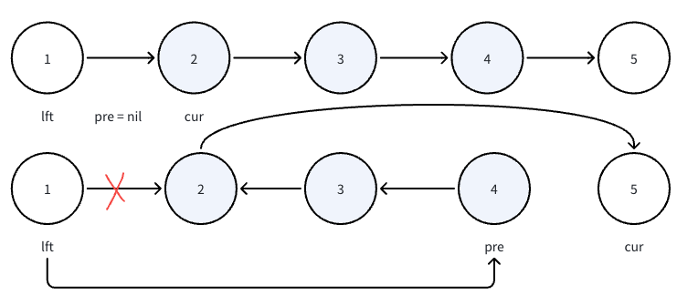

# 92. 反转链表 II

题目链接 : https://leetcode.cn/problems/reverse-linked-list-ii/description/

给你单链表的头指针 head 和两个整数 left 和 right ，其中 left <= right 。请你反转从位置 left 到位置 right 的链表节点，返回 反转后的链表 。

## 思路

非常难的一个题 太多边界了

1. 首先对于反转链表 我们还是使用 `pre` 进行处理

2. 我们需要处理的是，我们的 `cur` 节点， ==`cur` 需要从 Left 开始，因此我们需要先移动 Left 到指定的位置==

    - 这里我们记录了 `lft` 和 `cur = left.next` 即我们 左端点 和 左端点的左边节点

3. 翻转之后， 我们会得到一个 3个链表 如下

我们需要做以下几件事

1. 把反转链表的头节点 放入到 左侧 `lft.Next = pre`

2. 把反转链表的尾节点 连接到 右侧 `lft.Next.Next = cur` | ==这里很绕== 

3. 然后返回结果即可



## Code

```go
func reverseBetween(head *ListNode, left int, right int) *ListNode {
    dummy := &ListNode{Next: head}
    lft := dummy 
    for range left - 1 {
        lft = lft.Next
    }

    var cur , pre *ListNode = lft.Next, nil 

    for range right - left  + 1 {
        nxt := cur.Next
        cur.Next = pre 
        pre = cur
        cur = nxt
    }

    lft.Next.Next = cur 
    lft.Next = pre 
    return dummy.Next 
}
```